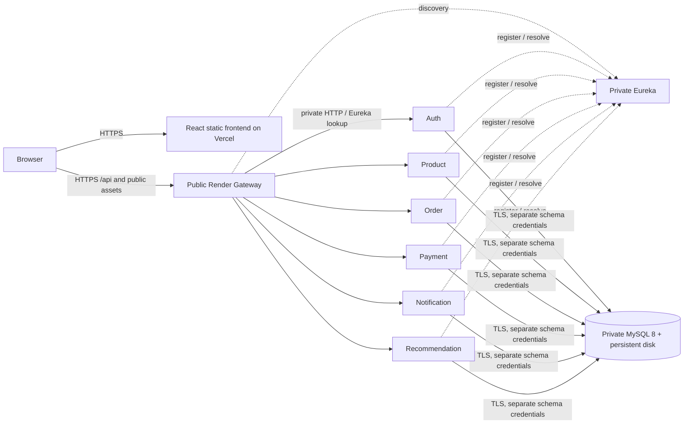

> The default `render.yaml` now uses an external managed MySQL database. Start with [MANAGED_MYSQL_DEPLOYMENT.md](MANAGED_MYSQL_DEPLOYMENT.md). This document retains the alternative self-managed MySQL design and shared deployment guidance. No cloud deployment has occurred.

# Render and Vercel deployment preparation

Prepared after the [15-feature audit](SMART_FEATURE_AUDIT.md), against application base `186b377`. Platform documentation checked on **26 October 2026**. **No cloud resources were created, deployed, deleted or changed. No production database or credentials were accessed or modified.** Applying a Blueprint and changing production are separate actions requiring approval. The prepared Blueprints disable automatic backend deployment.

The corrected baseline audit found 7 working workflows, 6 partial workflows and 2 missing customer features. Those gaps and the three recorded migration regressions were subsequently repaired; see [FINAL_VERIFICATION_REPORT.md](FINAL_VERIFICATION_REPORT.md) for current local acceptance. This configuration is a deployment candidate, not a claim that the application has passed all release acceptance criteria.

## 1. Existing configuration findings

| Area | Existing issue | Prepared change |
|---|---|---|
| Root Dockerfile | Built only the legacy backend with Java 17 | Java 21 multi-stage Gateway build by default; explicit module build argument supported |
| Eight service/infrastructure Dockerfiles | Java 17 runtime and prebuilt `target/*.jar` dependency | Root-context multi-stage Java 21 builds; common library built first; non-root runtime |
| Docker Compose | Literal `root` passwords, only one schema initialized, wrong Notification/Recommendation DB-variable names, localhost discovery advertisement | Replaced with isolated `shopease-preview` rehearsal, required environment secrets, six schema users, no MySQL host port and only a loopback Gateway host port |
| Render | No Blueprint | `render.self-hosted.yaml`: 9 services, manual deploys, no previews, Gateway maintenance mode |
| Spring | Fixed local ports, loopback advertised addresses, local DB defaults, broad development CORS | External `render` profile with required private hosts, dynamic port, TLS DB connection, exact Gateway origins and validate-only schema mode |
| Vercel | SPA rewrite exists; API client could silently fall back to localhost in a production build | Existing `frontend/vercel.json` retained; production build now requires a valid HTTPS `VITE_API_BASE_URL` |
| Brevo | Java REST implementation exists; real delivery depends on backend secrets | Explicit backend-only environment mapping and paused notification delivery until approved |
| Other hosting | A manual Netlify workflow points to an older backend and Node 20 | Left intact; it is not the proposed Vercel path. Review live hosting branch integrations before any future push/cutover. |

The legacy `backend/` application source and its Dockerfile remain available for rollback. Product's image resources still come from the existing `backend/src/main/resources/static` assets at **build time**; that is not a runtime monolith dependency. Curated frontend assets remain in `frontend/public` for Vercel.

## 2. Proposed topology



| Render service | Type / exposure | Port | Plan / storage |
|---|---|---:|---|
| `shopease-gateway` | Public web; initially maintenance mode | `${PORT}` = 10000 in Blueprint | `1c-2g`, one instance |
| `shopease-discovery` | Private service | 10000 | `1c-2g`, one instance |
| `shopease-auth`, `-product`, `-order`, `-payment`, `-notification`, `-recommendation` | Six private services | 10000 each, separate hosts | `1c-2g` each, one instance each |
| `shopease-mysql` | Private MySQL Docker service | 3306 | `1c-2g`, 10 GB disk at `/var/lib/mysql` |

Use the same **Render workspace and Singapore region** for these resources. These are proposed new service names; check for collisions and existing Blueprint ownership before applying. Do not import/replace a live service implicitly. Only Gateway is internet-reachable; business and service-key endpoints stay private. Render's same-region private hostnames are provided with Blueprint `fromService` references, not guessed names or IP addresses. [Render private networking](https://render.com/docs/private-network), [private services](https://render.com/docs/private-services).

This is a single-instance baseline. Eureka and MySQL are single points of failure. For a real commercial store requiring HA, choose managed MySQL with backups/replication and design redundant discovery before claiming production availability guarantees. The current email/outbox workers have not been certified for horizontal scaling; keep one instance per service.

## 3. Discovery, ports, CORS and health

`deploy/config/application-render.yml` is copied outside the jar and loaded through `SPRING_CONFIG_ADDITIONAL_LOCATION`. Blueprint activates `SPRING_PROFILES_ACTIVE=render`.

- Java binds `0.0.0.0:${PORT:10000}`. The entrypoint exports `SERVER_PORT` from `PORT` as well.
- `SERVICE_HOST` comes from each service's own private-host property. Eureka advertises that hostname, the actual port and a unique application/host/port instance ID; `prefer-ip-address=false` overrides local loopback advertisements.
- Every client uses `http://${DISCOVERY_HOST}:${DISCOVERY_PORT}/eureka/`. Business calls continue using logical Eureka names such as `http://auth-service`; Gateway routes continue using `lb://…`.
- The production entrypoint rejects loopback service/database hosts and a Product URI override that bypasses Eureka. Missing DB/secret settings fail startup rather than silently using local defaults.
- Database URLs require `DB_HOST`, `DB_NAME`, `DB_USERNAME`, `DB_PASSWORD`. Default `sslMode=REQUIRED` encrypts the private DB connection; use `VERIFY_IDENTITY` with a suitable trusted certificate for stricter identity verification. The self-managed MySQL image's automatic certificate is not a public-CA identity guarantee.
- Gateway uses only exact comma-separated HTTPS `CORS_ALLOWED_ORIGINS`. The canonical value is entered on Auth and referenced by Gateway. No blanket `*.vercel.app`, localhost origin or localhost backend fallback is used by the production Gateway profile. Auth retains its older private-service CORS implementation, but is not publicly exposed; Gateway is the browser-facing CORS boundary.
- Public Gateway health: `/actuator/health`. **Do not use the currently broken `/api/health` route as Render's health check.**
- Render private services support **TCP checks only**. Before release, also call every private service's `/actuator/health` and confirm Eureka UP registrations from inside the private network. Gateway health alone does not prove all downstream business services work. [Health-check rules](https://render.com/docs/health-checks).

Private host/port properties, generated values, secret prompts and manual-deploy fields follow the [official Blueprint specification](https://render.com/docs/blueprint-spec). `autoDeployTrigger: off` prevents subsequent commit-triggered deploys; **creating/applying a Blueprint still creates resources and initiates initial deploys**, so do not apply it without approval.

## 4. Environment inventory

| Variable | Where | Source / purpose |
|---|---|---|
| `SPRING_PROFILES_ACTIVE=render`, `PORT=10000` | Eight Java services | Blueprint runtime group |
| `SERVICE_HOST` | Each Java service | Its private host from `fromService` |
| `DISCOVERY_HOST`, `DISCOVERY_PORT=10000` | Java services | Private Eureka host reference |
| `DB_HOST`, `DB_PORT=3306` | Six business services | Private MySQL host; no public DB exposure |
| `DB_NAME`, `DB_USERNAME` | Each business service | `shopease_auth`, `shopease_product`, etc. |
| `AUTH_DB_PASSWORD`, `PRODUCT_DB_PASSWORD`, etc. | MySQL initialization environment | Separate generated secrets; each owner receives only its own value as `DB_PASSWORD` |
| `MYSQL_ROOT_PASSWORD` | MySQL only | Generated administrative secret; never supplied to application services |
| `SERVICE_INTERNAL_KEY` | Shared Java runtime group | Generated once for the new isolated stack, at least 32 bytes; stable across deployments |
| `JWT_SECRET` | Auth only | Manual secret input after approval; retain the current approved signing key if sessions must survive cutover. Never rotate existing credentials automatically. |
| `CORS_ALLOWED_ORIGINS` | Auth, referenced by Gateway | Exact Vercel production/custom origins, comma-separated, without trailing paths |
| `BREVO_API_KEY`, `BREVO_SENDER_EMAIL`, `BREVO_SENDER_NAME` | Auth and Notification | See Brevo section below; Notification references Auth's configured values |
| `NOTIFICATION_DELIVERY_ENABLED=false` | Runtime group; read by Notification | Pauses email/SMS workers until an explicitly approved send/release; in-app events still persist |
| `DEMO_PAYMENTS=false` | Runtime group | COD remains available; UPI/card hidden unless the operator explicitly enables the existing demo. No real payment gateway is implemented. |
| `OPENAI_API_KEY`, `OPENAI_MODEL` | Optional Recommendation runtime only | Do not set by default or in Vercel. Optional assistant rewrite path is not verified by this audit. |

The MySQL bootstrap runs only for a **new empty data directory**. It creates six schema-scoped users with SELECT/INSERT/UPDATE/DELETE, not root or cross-schema access. Restore/migration DDL is an explicitly approved admin operation. Changing environment variables on an existing MySQL disk does not rotate the database's stored users/passwords, and must not be presented as credential rotation.

The entrypoint requires Brevo settings for Auth/Notification under `render`; this prevents accidentally publishing demo OTP codes by deploying without mail configuration. Wrong/nonfunctional provider credentials still cause delivery failure: successful real provider delivery remains a release test, not a configuration-presence assertion.

No secrets are committed. `.dockerignore` excludes local files, environment files, credentials, dumps, build outputs and Git metadata. Dockerfiles declare only the non-secret `MODULE` build argument; Render translates environment variables to build arguments, so secret ARG declarations or logging must not be added. [Docker environment handling](https://render.com/docs/docker).

## 5. Exact Vercel setup

After approval, create a Vercel project with:

- Repository branch: the reviewed migration/release branch; do not change main.
- Root Directory: **`frontend`**.
- Framework: **Vite**; install `npm ci`; build `npm run build`; output **`dist`**.
- Use a Node version satisfying the existing package engine (`>=22.12.0`). Confirm the selected supported version in Vercel before creating the deployment.
- Retain `frontend/vercel.json`, which rewrites SPA routes to `/index.html`.
- Set the **build-time public variable** exactly:

```text
VITE_API_BASE_URL=https://<actual-public-render-gateway-host>/api
```

Use Gateway's actual external HTTPS URL from Render, **not Auth, Product, Eureka, the old monolith or a private hostname**. Include `/api`. The new build validation rejects missing, insecure or loopback production URLs. Dev mode still defaults to `http://localhost:8080/api`.

Changing this variable requires a new Vercel build; existing bundles do not change. `VITE_*` values are client-visible, so the API base URL is the only deployment value needed in the browser—never put Brevo, DB, JWT or service-key secrets there. [Vercel environments](https://vercel.com/docs/environment-variables), [Vite environment exposure](https://vite.dev/guide/env-and-mode).

Set Gateway/Auth CORS to the actual production Vercel origin and any approved custom domain. Do not allow every Vercel preview. If previews are needed, use a separate staging API and explicitly reviewed origins. Confirm relative product-photo URLs exist in Vercel's `public` output; preserve the existing curated assets. No database URL rewrite is performed automatically.

## 6. Brevo: REST, not SMTP

Both Auth and Notification `MailService` classes use Java's HTTPS client to:

```text
POST https://api.brevo.com/v3/smtp/email
api-key: <backend BREVO_API_KEY>
```

The `smtp` segment in the REST URL does **not** mean SMTP transport. The implementation sends JSON with `sender`, `to`, `subject` and `htmlContent`; there is no configured Java SMTP transport. `spring.mail.*`, SMTP host/port and SMTP password settings would not activate this code. Use a **Brevo API key**, not an SMTP key. [Transactional API](https://developers.brevo.com/reference/send-transac-email).

After approval:

1. Use a verified sender address and authenticate its domain through the Brevo account; complete the required DNS records. Do not change domain/production credentials without explicit approval. [Senders/domains](https://developers.brevo.com/docs/getting-started-with-senders-and-domains).
2. Enter `BREVO_API_KEY` as a protected backend secret; `BREVO_SENDER_EMAIL` must match the verified sender, and `BREVO_SENDER_NAME=ShopEase` is non-secret.
3. Test OTP delivery and a single notification to an explicitly approved test recipient. Check acceptance plus inbox delivery; a Brevo HTTP success is not proof of delivery to the recipient.
4. Keep `NOTIFICATION_DELIVERY_ENABLED=false` during restore/review. Inspect pending jobs and recipients before enabling it. Do not replay historical `DEMO_SKIPPED` jobs or send restored notifications to real customers accidentally.
5. Enable delivery only after approval; monitor the owned email-delivery ledger for SENT/PENDING and failures. The current code retries provider failures but has not been validated against real Brevo rejection/rate-limit scenarios in this task.

Brevo Free currently includes **300 emails/day** shared across OTPs and notifications; unused daily quota does not carry over. Plan for multiple messages per checkout plus registration/reset activity. [Brevo limits](https://help.brevo.com/hc/en-us/articles/208580669-FAQs-What-are-the-limits-of-the-Free-plan).

Render's free web services block outbound SMTP ports 25/465/587; this code uses HTTPS 443. The proposed paid services do not make SMTP necessary. [Render SMTP restriction](https://render.com/changelog/free-web-services-will-no-longer-allow-outbound-traffic-to-smtp-ports).

## 7. Customer-data backup and migration plan

**Do not restore over the only live database, reset a volume or deploy a blank catalogue as if migration succeeded.** Start with a new, isolated MySQL instance/volume and keep the original systems available for rollback.

1. Record the current release commit, table counts/checksums, migration ledgers and signing-key provenance. Run the read-only reference/migration audit. Decide explicitly whether to keep or filter synthetic verification data in the new copy; do not silently delete test history or real records. Full exports include the synthetic financial fixtures currently retained for audit.
2. Before final cutover, stop new writes through an approved maintenance window. Quiesce in-flight checkout intents/outboxes; record unresolved work and keep provider delivery paused. A consistent DB snapshot can capture an in-progress saga, so inspect recovery work before reopening traffic.
3. Export **all seven schemas in one snapshot**: original `ecommerce_db` **and all six owned schemas**, including customer/user password hashes, order/payment IDs, outboxes/inboxes, migration ledgers and recommendation history. Copying only the original monolith database would lose post-migration service writes.
4. Prepared helper: `tools/deployment/backup-mysql.ps1`. It uses `mysqldump --single-transaction --quick --hex-blob --routines --triggers --events --no-tablespaces --set-gtid-purged=OFF`, never a command-line password, and saves a SHA256 manifest without overwriting an existing export. The helper was syntax-checked but **not run against production**.
5. Encrypt the export, restrict file permissions, and retain an off-host copy plus the original. Test restoration into an isolated instance before touching the release database. Disk snapshots alone are **not a valid MySQL backup/restore procedure**. Render explicitly recommends database-aware tools rather than disk restore for MySQL. [Render MySQL backups](https://render.com/docs/deploy-mysql).
6. After explicit deployment/data-import approval, apply the reviewed Blueprint to new resources. MySQL initializes empty owned schemas and DML users. Java services use `ddl-auto=validate`, so initial service deploys may fail until the approved schema/data restore completes; this is intentional, not a reason to enable `create` or `update`. Keep Gateway maintenance mode enabled and notification workers paused. Render Blueprint creation is not a database-migration transaction or guaranteed startup ordering mechanism.
7. An approved administrator uses Render's private service shell/SSH and an encrypted, short-lived transfer to restore with the MySQL client into the **new empty** instance. Do not expose port 3306 publicly. Do not restore the `mysql` system schema or overwrite generated database users/credentials. The backup contains only application schemas. Never bake exports into an image or Git.
8. Re-run row-count/checksum comparisons against the exported baseline and all relationship checks. Preserve migration ledgers and existing password hashes; never rerun seeders. Use admin-only audit access for offline cross-schema checks; app users remain schema-scoped. For an already migrated system, restore its owned schemas directly rather than re-copying the stale monolith tables.
9. Redeploy failed services manually after restoration and confirm each actuator health, Eureka registration, owner headers and the complete customer/admin acceptance suite. Run actual TLS/private-DNS checks and a controlled redeploy/persistence test. Verify no production URLs still target loopback or the legacy backend.
10. Only after explicit cutover approval, build Vercel against the new Gateway, validate CORS, inspect provider recipients/jobs, enable notification delivery and remove Gateway maintenance mode. Preserve the old stack and exports for the agreed rollback period; do not delete services or disks.

Rollback before new writes: point the frontend back to its approved previous API and keep the new stack in maintenance. After new writes, rollback requires planned reconciliation of those writes; do not overwrite the new financial records with an older backup. Schedule encrypted off-host logical backups, verify restore drills and monitor disk capacity after launch. The proposed single MySQL disk does not provide HA or point-in-time recovery by itself.

Example **future approved local export**, not executed here:

```powershell
# Supply DB_PASSWORD securely in the admin process environment; do not commit it.
.\tools\deployment\backup-mysql.ps1 -OutputDirectory '<encrypted-backup-staging-directory>'
```

## 8. Cost and plan limitations

The Blueprint deliberately selects **`1c-2g` for all nine services**, allowing memory headroom for Java/JPA and MySQL. This is an initial capacity choice, not a load-test guarantee. Render's newer plan IDs were introduced in August 2026; `1c-2g` maps to the former Standard tier. [Compute plans](https://render.com/docs/compute-plans).

| Item | Estimate / limitation |
|---|---|
| Render compute | 9 × $25/month = **$225/month** |
| MySQL persistent disk | 10 GB × $0.25/GB/month = **$2.50/month** |
| Baseline Render subtotal | **About $227.50/month**, before workspace charges, bandwidth, taxes, backup storage or other usage |
| Optional smaller Java tier | `0.5c-512mb` is listed at $7/month, but six JPA services plus discovery/Gateway must be measured before reducing memory. It is not the prepared Blueprint default. |
| Vercel | Hobby can suit a personal non-commercial college demo; commercial use requires an appropriate paid plan (Pro starts around $20/user/month plus usage). |
| Brevo | Free tier's 300/day may suit a small demo, not unrestricted transactional volume. |

Pricing is an estimate based on current official material, not an approved purchase. Recheck the dashboard before applying. [Render compute price examples](https://render.com/articles/production-rails-hosting-guide), [Render pricing/disk rates](https://render.com/pricing), [Vercel Hobby restrictions](https://vercel.com/docs/plans/hobby).

All-free Render hosting does not fit this architecture: private services require paid compute, free web services cannot receive private-network requests, and a persistent disk requires a paid service. A disk is single-instance and prevents zero-downtime redeploy of its attached MySQL service; only changes under its mount persist. [Private networking](https://render.com/docs/private-network), [persistent disk constraints](https://render.com/docs/disks).

## 9. Validation actually performed

| Check | Result |
|---|---|
| `render.self-hosted.yaml` against Render's downloaded official JSON Schema | PASS: 9 service definitions |
| Prepared topology/secret/schema/maintenance/delivery checks | PASS via `tools/deployment/validate.py` |
| Java entrypoint and MySQL bootstrap Bash syntax | PASS |
| Production entrypoint rejects loopback service host | PASS: exit 2 before launching Java |
| Local JVM using actual `render` profile on temporary port 18180 | PASS: actuator 200, Product catalogue 200 via Eureka |
| Exact-origin production Gateway CORS | PASS: two configured HTTPS origins accepted; unapproved Vercel and localhost origins rejected with 403 |
| Frontend tests | PASS: 31 tests, zero failures |
| HTTPS production frontend build | PASS using a non-deployed reserved `.invalid` audit URL |
| Production localhost frontend build | Correctly rejected; expected negative-test failure |
| Notification tests | PASS: 3 tests, including disabled email/SMS worker gate |
| Backup helper PowerShell syntax | PASS; no production export executed |
| Docker image build / `docker compose up` | **Not run: Docker CLI/daemon unavailable on this machine** |
| Actual Render/Vercel private DNS, DB TLS, platform health routing, restore/persistence and real Brevo delivery | **Not run: requires approved staging deployment/credentials** |

The local profile probe used explicit local test overrides for discovery and never registered an extra Gateway in Eureka. It demonstrates Spring binding, discovery and CORS behaviour, not Render network reachability. The first Windows probe failed because of the long temporary-path networking issue, then passed with the established short `.local/tmp` settings. No such result is represented as a cloud deployment test.

Reproduce static validation (Python needs PyYAML and jsonschema):

```powershell
Invoke-WebRequest https://render.com/schema/render.yaml.json -OutFile .local/deployment-prep/render-schema.json
python tools/deployment/validate.py --schema .local/deployment-prep/render-schema.json
cd frontend
$env:VITE_API_BASE_URL='https://<approved-gateway-host>/api'
npm test
npm run build
```

Container build/rehearsal commands are prepared for an environment with Docker, **not executed here**:

```text
docker build -f api-gateway/Dockerfile -t shopease-gateway:review .
docker build -f services/product-service/Dockerfile -t shopease-product:review .
docker compose --env-file <ignored-local-env-file> config
docker compose --env-file <ignored-local-env-file> build
```

The Compose project uses a new `shopease-preview` volume and does not reuse or delete existing local volumes. Its `container` profile is only for local rehearsal; never activate it on Render. Apply/start/restore/cutover/provider sends and credential changes remain pending explicit approval.
